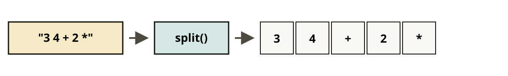

<!-- .slide: class="title-slide" -->

Scripting Languages / 02
<!-- .element: class="kicker" -->

# テキスト処理と文章生成

### スクリプト言語演習 第2回

---

## 今日のゴール: 文章をまねる生成器を作る

手元の文章を読み込み、**その文章らしい新しい一文**を作る。
<!-- .element: class="lead" -->


結論: <strong>状態・表・ループ</strong>があれば、文章を作るプログラムが書ける。
マルコフ連鎖は、その考え方を使う最初の例だ。
<!-- .element: class="key-box" -->

---

## 第1回の道具をそのまま使える

| 第1回で作ったもの | 今回の使い道 |
|---|---|
| `split` で文字列を分ける | 単語に分ける出発点 |
| 辞書 | 「単語 → 次の語の回数」を記録する |
| ディスパッチテーブル | 「記号 → 実行する操作」を登録する |
| 登録デコレータ | 操作をあとから追加する |

---

## 文字列を単語に分ける

```python
import re

text = "Hello, world! It's a nice day."

text.split()                        # 記号が残る
re.findall(r"[a-z']+", text.lower())
# ['hello', 'world', "it's", 'a', 'nice', 'day']
```



結論: 文字列は、意味のある単位である<strong>トークン</strong>に分けてから扱う。
この作業を<strong>字句解析</strong>と呼ぶ。文章生成でも電卓でも、まずここから始まる。
<!-- .element: class="key-box" -->

---

## 隣り合う単語を数えると、次の候補が分かる

```python
from collections import Counter, defaultdict

Counter(words)["the"]       # 3
Counter(words).most_common(2)
```

「この語の次に何が来たか」は、隣り合う2語を数えると分かる。

```python
following = defaultdict(Counter)      # 空の Counter を作る

for a, b in zip(words, words[1:]):    # 隣り合う2語を順に取り出す
    following[a][b] += 1
```

結論: この3行で「単語 → 次の語の回数」の表ができる。
<code>Counter</code> は初めて出る語の回数も 0 から数え始める。
<!-- .element: class="key-box" -->

---
<!-- .slide: class="chapter" -->

設計図
<!-- .element: class="num" -->

## 状態を表とループで更新する

---

### 文章生成も電卓も、次の状態を作る

| 機械 | 状態 | 表に入れるもの | ループで行うこと |
|---|---|---|---|
| 文章生成 | 今の単語 | 次に来た語と回数 | 次の語を選ぶ |
| 電卓 | 数のスタック | 記号と操作の関数 | 1トークンを実行する |

結論: <strong>状態を持つ → 表から次の処理を選ぶ → 状態を更新する</strong>。
この同じ形を、まず文章生成で使い、次に電卓でも使う。
<!-- .element: class="key-box" -->

---

### 状態を1語にすると、文章が続く

今の単語だけを見て次の単語を決める。これを繰り返す。
<!-- .element: class="lead" -->


結論: 覚えるのは直前の1語だけでも、元の文章らしい<strong>くせ</strong>は残る。
<!-- .element: class="highlight-box" -->

---

### 表は「次に来る語の回数」を持つ

```python
def build_table(tokens):
    table = defaultdict(Counter)
    for a, b in zip(tokens, tokens[1:]):
        table[a][b] += 1
    return table

text = "I like cats. I like dogs. I love cats."
table = build_table(text.lower().replace(".", "").split())
```

```text
table["i"]     -> Counter({'like': 2, 'love': 1})
table["like"]  -> Counter({'cats': 1, 'dogs': 1})
```

結論: <code>table&#91;"i"&#93;</code> は「i の次に何が来るか」の確率を表す。
ここでは、<strong>like が 2/3、love が 1/3</strong> になる。
<!-- .element: class="key-box" -->

---

### 回数を重みにして、次の語を選ぶ

```python
import random

def pick_next(counter):
    words = list(counter.keys())
    weights = list(counter.values())      # 回数を重みにする
    return random.choices(words, weights=weights)[0]

pick_next(table["i"])    # 'like' が出やすく、'love' がたまに出る
```

注意: <code>random.choice</code> は等確率で選ぶ。
回数に応じて選ぶには <code>random.choices</code> を使う。返り値は<strong>リスト</strong>なので、
末尾の <code>&#91;0&#93;</code> を付ける。
<!-- .element: class="warn-box" -->

---

### 状態を更新すると、文章が続く

```python
def generate(table, start, n=30):
    word = start
    result = [word]
    for _ in range(n):
        if word not in table:      # 次の語がなければ終える
            break
        word = pick_next(table[word])
        result.append(word)
    return " ".join(result)
```

結論: <strong>予測する → 選ぶ → つなげる</strong>を繰り返すと、文章ができる。
今の語が<strong>状態</strong>、<code>table</code> が<strong>表</strong>、<code>for</code> が
状態を更新する<strong>ループ</strong>だ。
<!-- .element: class="key-box" -->

---

### 温度で文章の意外さを調整する

温度 `T` を使うと、よく出る語を選ぶ度合いを変えられる。
重みを `1/T` 乗してから次の語を選ぶ。

```python
weights = [c ** (1 / temperature) for c in counter.values()]
```

| 温度 | 重み `(3, 1)` | 出力の傾向 |
|---|---|---|
| `0.1` | `(59049, 1)` | 最頻語に偏る。安定するが単調 |
| `1.0` | `(3, 1)` | 元の統計どおり |
| `5.0` | `(1.25, 1)` | ほぼ等確率。多様だが崩れやすい |

結論: 温度は、確率の偏りを強くしたり弱くしたりする調整つまみだ。
<!-- .element: class="key-box" -->

---

### 文脈を増やすほど、表は大きくなる

直前の2語を見ると出力は自然になる。ただし、必要な表は急に大きくなる。

| 見る語数 | 出力の傾向 | 問題 |
|---|---|---|
| 1語 (bigram) | 単語のつながりは自然 | 文の意味は崩れやすい |
| 2語 (trigram) | かなり自然になる | 元の文章を写しやすい |
| 5語 | ほぼ丸写し | 組み合わせが表に無くなる |

結論: 長い文脈を使うほど、表に必要な組み合わせが増える。
これが、数え上げだけで文章を作る方法の限界だ。
<!-- .element: class="key-box" -->

---
<!-- .slide: class="chapter" -->

もう一つの状態
<!-- .element: class="num" -->

## 複数の値はスタックに覚えさせる

文章生成では、今の単語だけを覚えていた。計算では途中の値をいくつも覚えたい。
そこで、最後に入れた値から使う<strong>スタック</strong>を状態にする。

---

### 逆ポーランド記法では、式を左から読む

`3 4 +` を左から読み、最後に入れた値から取り出す (LIFO)。

| 読んだもの | やること | スタック |
|---|---|---|
| `3` | 数なので push | `[3]` |
| `4` | 数なので push | `[3, 4]` |
| `+` | 2つ pop して足し、結果を push | `[7]` |

結論: Python ではリストをそのままスタックとして使える。
`append` が push、`pop` が pop になる。
<!-- .element: class="note" -->

注意: <code>10 3 -</code> の結果は <code>7</code>。先に pop されるのは <code>3</code> だ。
引き算と割り算では、取り出す順序を逆にしない。
<!-- .element: class="warn-box" -->

---

### 表に関数を入れると、操作を追加できる

結論: 表の値を関数にすると、記号ごとの操作を後から足せる。
「単語 → 次の候補」だった表を「記号 → スタックを更新する関数」に替え、
第1回の登録デコレータを <code>@word</code> として使う。

```python
WORDS = {}

def word(name):                      # 第1回の @command と同じ形
    def deco(func):
        WORDS[name] = func
        return func
    return deco

@word("+")
def _(stack):
    b, a = stack.pop(), stack.pop()
    stack.append(a + b)

@word("DUP")
def _(stack):
    stack.append(stack[-1])
```

---

### 評価ループは、6行のまま増やせる

```python
def evaluate(stack, text):
    for token in text.split():       # トークンに分ける
        if token in WORDS:
            WORDS[token](stack)      # 表から関数を選ぶ
        else:
            stack.append(int(token))
```


結論: 操作を増やしても、評価ループは変わらない。
文章生成と同じく、まず表から取り出す。候補を選ぶ代わりに、
<strong>関数を呼んでスタックを更新する</strong>。
<!-- .element: class="key-box" -->

---

## 同じ骨格で2つの機械が動く

| | 文章を作る機械 | 計算する機械 |
|---|---|---|
| 状態 | 今の単語 | 数のスタック |
| 表 | 次の語の回数 | 記号と操作 |
| 更新 | 確率に従って選ぶ | 関数を実行する |

結論: <strong>辞書とループ</strong>があれば、確率的な生成器も小さな言語も作れる。
表の中身を替えるだけで、同じ骨格が別の機械になる。
<!-- .element: class="key-box" -->

---
<!-- .slide: class="chapter" -->

付録
<!-- .element: class="num" -->

## 課題で使う道具: ファイル・正規表現・スタック

---

### `with` を使うと、ファイルを安全に読める

```python
with open("data.txt", encoding="utf-8") as f:
    text = f.read()          # ファイル全体を文字列として読む

with open("data.txt", encoding="utf-8") as f:
    for line in f:           # 1行ずつ読む（大きなファイル向け）
        line = line.strip()
        if not line or line.startswith("#"):
            continue
```

結論: `with` を使えば、途中で例外が起きてもファイルを閉じられる。
日本語を扱うときは `encoding="utf-8"` を指定する。省略すると環境によっては文字化けする。
<!-- .element: class="note" -->

---

### 正規表現は、文字列から必要な部分を取り出す

| 記法 | 意味 |
|---|---|
| `.` | 任意の1文字 |
| `\d` `\w` `\s` | 数字 / 英数字とアンダースコア / 空白 |
| `[abc]` `[^abc]` | いずれか1文字 / それ以外1文字 |
| `*` `+` `?` | 0回以上 / 1回以上 / 0か1回 |
| `( )` | グループ。取り出したい部分を囲む |

```python
re.findall(r"[a-z']+", text)     # すべて取り出す
re.sub(r"\d+", "N", text)        # 置き換える
m = re.match(r"(\d{4})-(\d{2})", s)
if m: year, month = m.groups()   # マッチしないと None が返る
```

結論: 正規表現のパターンは `r"..."` で書く。
`split` で足りるなら、まず `split` を使う。
<!-- .element: class="note" -->

---

### 並べ替えとスタック操作は、課題で使う

```python
sorted(counts.items(), key=lambda kv: (-kv[1], kv[0]))
# 回数が多い順。同じ回数なら辞書順
```

| ワード | 動作 | スタックの変化 |
|---|---|---|
| `DUP` | 一番上を複製 | (a → a a) |
| `DROP` | 一番上を捨てる | (a → ) |
| `SWAP` | 上2つを入れ替え | (a b → b a) |
| `OVER` | 2番目を上にコピー | (a b → a b a) |
| `ROT` | 3番目を一番上へ | (a b c → b c a) |

---
<!-- .slide: class="chapter" -->

課題
<!-- .element: class="num" -->

## 課題では小さな機械を段階的に作る

---

## 前の課題の結果を次の課題で使う

結論: 1問ずつ動かして確かめれば、最後まで自力で進められる。
前の課題の出力が、次の課題の入力になる。

| # | 課題 | ねらい |
|---|---|---|
| 1 | 文章をトークンに分ける | ファイル入出力、正規表現 |
| 2 | 「次に来る語」の表を作る | `defaultdict`、`Counter`、`zip` |
| 3 | 表を使って新しい一文を作る | 重み付き抽選、生成ループ |
| 4 | 表の値を操作に替え、電卓を動かす | スタック、ディスパッチ |

発展: 温度を変えて文章の意外さを比べる / 直前2語を見る生成器にする

---

## 進め方

- ページの「Colab で開く」から課題を開き、「ドライブにコピーを保存」しておく
- 最初に準備セルを実行する
- 各課題の `TODO` を埋めたら、直下の確認セルを実行する
- 確認セルは変更せず、出力を残したままノートブックを保存する
- `score()` で全問を確認してから提出する

結論: 課題1〜3で「語を状態にする機械」が完成する。
課題4では同じ骨格のまま状態をスタックに替える。面白い出力や自作ワードを共有しよう。
<!-- .element: class="key-box" -->
