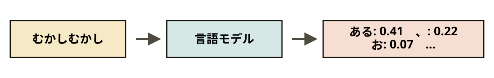
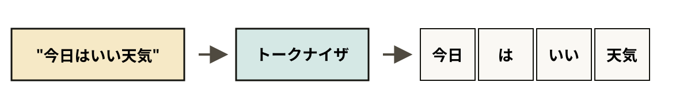
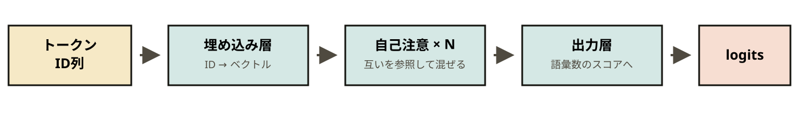

<!-- .slide: class="title-slide" -->

Scripting Languages / 03-A
<!-- .element: class="kicker" -->

# 言語モデルの仕組みと実装

### スクリプト言語演習 第3回 (A)

---

## 今日のゴール

- 手元で Transformer を実行
- 次の1トークンを選ぶ処理を、自分で実装
- 最後に、簡単な応答プログラムを作成

APIキーは不要。モデルをダウンロードし、自分の環境で実行
<!-- .element: class="note" -->

---

## 第2回でもう作っている

- 次の語の予測も、選んでつなげるループも同一
- 違うのは、回数の表が学習済みの関数になった点
- 温度も、第2回のものをそのまま利用可能

| | 第2回：マルコフ連鎖 | 今日：言語モデル |
|---|---|---|
| 次の語の予測 | `table[word]` を引く | `model(文脈)` を呼ぶ |
| 予測の中身 | 数えた回数の表 | 学習した重み |
| 見ている文脈 | 直前 1〜2 語 | 直前 数千トークン |
| 選び方 | `random.choices` + 温度 | サンプリング + 温度 |

---

## 言語モデルがやっていること

- 入力は「ここまでの文字列」
- 出力は文章ではなく、語彙それぞれの確率
- 長い文章も、1ステップの繰り返しで生成



生成がループになるのは、一度に1トークンしか返さないため
<!-- .element: class="note" -->

---

## トークンと logits

- トークンは、単語とも1文字とも限らない
- よく現れる文字列をまとめた、統計的な単位
- logits に `softmax` を通すと確率

```python
probs = torch.softmax(logits, dim=-1)   # すべて 0 以上、合計 1
```



---

## 1ステップだけ動かす

- トークナイザで文字列を ID に変換
- `model(ids)` の形は (バッチ, 系列長, 語彙数)
- 次に使うのは最後の位置なので `[0, -1]` を取得

```python
from transformers import AutoTokenizer, AutoModelForCausalLM
tok = AutoTokenizer.from_pretrained("Qwen/Qwen2.5-0.5B-Instruct")
model = AutoModelForCausalLM.from_pretrained("Qwen/Qwen2.5-0.5B-Instruct")

ids = tok("むかしむかし、あるところに", return_tensors="pt").input_ids
with torch.no_grad():
    logits = model(ids).logits[0, -1]

probs = torch.softmax(logits, dim=-1)
top = torch.topk(probs, 5)
# お 0.312    一 0.145    おじいさん 0.098
```

Colab があれば開始可能。GPU なら速いが、CPU でも動作
<!-- .element: class="note" -->

---

<!-- .slide: class="chapter" -->

01
<!-- .element: class="num" -->

## 生成ループを書く

---

## greedy：一番高い語を選び続ける

- 毎回、確率が最大のトークンを選択
- 終端トークンが出たら停止
- 第2回の `pick_next` が `argmax` に変わっただけ

```python
def generate_greedy(prompt, max_new_tokens=40):
    ids = tok(prompt, return_tensors="pt").input_ids
    for _ in range(max_new_tokens):
        with torch.no_grad():
            logits = model(ids).logits[0, -1]
        next_id = torch.argmax(logits)
        if next_id.item() == tok.eos_token_id:
            break
        ids = torch.cat([ids, next_id.view(1, 1)], dim=1)
    return tok.decode(ids[0])
```

---

## greedy の弱点

- 同じ入力なら、いつも同じ出力
- いちばん高い語だけを拾うので、単調になりやすい
- そこで、分布からランダムに選択

```text
>>> generate_greedy("好きな食べ物は")
好きな食べ物は何ですか？好きな食べ物は何ですか？好きな食べ物は...
```

そのままでは低い語も拾うので、分布を整えてから選択
<!-- .element: class="note" -->

---

## 温度と top-k

- 温度で割ってから softmax
- 小さい数で割れば差が開き、大きい数で割れば縮小
- 上位 k 個に絞れば、低い語を候補から除外

```python
def sample_next(logits, temperature=0.8, k=50):
    probs = torch.softmax(logits / temperature, dim=-1)
    top = torch.topk(probs, k)
    idx = torch.multinomial(top.values, 1)
    return top.indices[idx]
```

第2回では回数を `c ** (1/T)` していた。logits は確率の対数なので、割り算が同じ役割
<!-- .element: class="note" -->

---

## 発展: top-p サンプリング

- 確率の高い順に足し、合計が p に達したら停止
- 偏っているときは候補が少なく、分散しているときは多い
- `p = 0.9` あたりが定番。`k=1` なら greedy と同じ

```python
probs = torch.softmax(logits / temperature, dim=-1)
sorted_probs, sorted_idx = torch.sort(probs, descending=True)
cumsum = torch.cumsum(sorted_probs, dim=-1)
mask = cumsum - sorted_probs < p
next_id = sorted_idx[mask][torch.multinomial(sorted_probs[mask], 1)]
```

課題の発展で実装。本編では温度と top-k で十分
<!-- .element: class="note" -->

---

<!-- .slide: class="chapter" -->

02
<!-- .element: class="num" -->

## 会話形式で応答させる

---

## 素のモデルは続きを書くだけ

- 追加学習で、「指示 → 応答」の書式を保持
- `apply_chat_template` が、その書式の文字列を生成
- あとは、いつもの生成ループへ

```python
messages = [
    {"role": "system", "content": "あなたは簡潔に答えるアシスタントです。"},
    {"role": "user",   "content": "日本の首都は？"},
]
prompt = tok.apply_chat_template(
    messages, tokenize=False, add_generation_prompt=True)
```

```text
入力: 日本の首都は
出力: 日本の首都は東京である。人口は約1400万人で...
```

---

## 中身はただの文字列

- 特殊トークンで、役割の区間を区切る
- モデルがやりとりを覚えているわけではない
- 「文脈を覚えている」ように見えるのは、そのため

<pre><code class="language-text">&lt;|im_start|&gt;system
あなたは簡潔に答えるアシスタントです。&lt;|im_end|&gt;
&lt;|im_start|&gt;user
日本の首都は？&lt;|im_end|&gt;
&lt;|im_start|&gt;assistant
</code></pre>

この文字列を、先ほどの生成ループへ
<!-- .element: class="note" -->

---

## 気をつけること

- 会話が長くなると遅くなり、入力上限も超過
- 0.5B では、もっともらしい嘘が頻繁
- 実務では `model.generate(...)` を使用

| 問題 | 対処 |
|---|---|
| 会話が長い / 入力上限 | 古いやりとりを削る |
| 同じ語の繰り返し | 温度を上げる / 既出語の logits を下げる |
| 事実ではない答え | 事実確認に使わない |
| 1トークンずつ再計算 | 本来は KV キャッシュで使い回す |

内部では同じ処理を、はるかに効率よく実行
<!-- .element: class="note" -->

---

## まとめ

- 言語モデルは、次の1トークンの確率分布を返す関数
- 生成は、予測 → 選ぶ → つなげる、のループ
- 会話は、履歴を毎回すべて渡すことで成立

違うのはモデルの大きさと、実装の速さだけ
<!-- .element: class="note" -->

---

<!-- .slide: class="chapter" -->

付録
<!-- .element: class="num" -->

## Transformer の中身

---

## 箱の中で起きていること

- トークンをベクトルにし、注意機構で文脈を混合
- 最後に語彙サイズの logits を出力
- 理論は機械学習の講義へ



中身を全部実装しなくても、入出力だけ扱えれば生成ループは記述可能
<!-- .element: class="note" -->

---

<!-- .slide: class="chapter" -->

課題
<!-- .element: class="num" -->

## 生成ループを実装する

---

## 取り組む課題

- まず候補と確率を目で確認
- greedy のあと、温度と top-k を追加
- 最後に、チャットテンプレートで会話を生成

| # | 課題 |
|---|---|
| 1 | 次のトークンの上位10候補と確率を表示する |
| 2 | `generate_greedy` を完成させ、同じ入力で結果が一致することを確かめる |
| 3 | 温度付き top-k を実装し、温度 0.3 / 0.8 / 1.5 で比べる |
| 4 | チャットテンプレートで3往復の会話を生成する |

発展: top-p サンプリング / 繰り返しペナルティ
<!-- .element: class="note" -->

---

## 進め方

- 「Colab で開く」から課題を開き、「ドライブにコピーを保存」
- 最初の2セルを実行し、各課題の `TODO` を埋める
- 確認セルは消さない。最後に `score()` を実行してから提出
