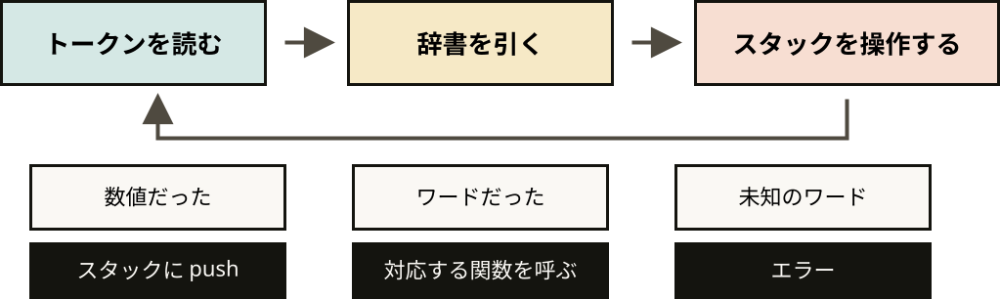

Scripting Languages / Dynamic Languages / 03-B

# Forth インタプリタの実装

### スクリプト言語演習

---

## 本日の成果物

- 土台となる第2回の逆ポーランド電卓
- `: 名前 ... ;` による、実行中の語彙の追加
- 語彙の増加による、電卓から言語への発展

> 組み込みワードと自作ワードを同じループで実行する処理系

---

## Forth とは

- スタックを中心に計算と制御を組み立てる言語
- 空白で区切ったワードを順に実行するプログラム
- 語彙を実行中に増やせる、拡張可能な処理系

| 特徴 | 内容 |
|---|---|
| 逆ポーランド記法 | `3 4 +` のように演算子を後ろに書く |
| スタック指向 | 引数も返り値もすべてスタック経由 |
| 文法がほぼない | 空白区切りの「ワード」が並んでいるだけ |
| 拡張が前提 | 組み込みとユーザ定義を区別しない |

> 字句解析とディスパッチだけで作る、小さな処理系

---

## Forth を選ぶ理由

- 構文が小さく、字句解析は空白での分割だけ
- 実行時の状態はスタック、操作はワード辞書という明快な構造
- 組み込みワードと自作ワードを同じ仕組みで扱う拡張性

| これまでの道具 | Forth での役割 |
|---|---|
| 文字列の分割 | ワードへの字句解析 |
| 辞書と関数 | ワード辞書とディスパッチ |
| スタック | 計算途中の値の保持 |

> 小さな実装で、インタプリタの主要部品をすべて確認できる題材

---

## 第2回の電卓の再利用

- 第2回のトークン化とスタック
- 第1回のディスパッチと同じ形のワード表
- スタックと辞書による電卓の再構成

| 回 | 作ったもの | 今日の役割 |
|---|---|---|
| 第1回 | `@command` と `run()` | ワード辞書とディスパッチ |
| 第1回 | ディスパッチテーブル | 組み込みワードの実装 |
| 第2回 | `split` によるトークン化 | 字句解析 |
| 第2回 | 逆ポーランド電卓 | 今日の出発点 |

---

## スタック計算

- 式の左から右への読み取り
- 数の push と、演算子での2値の pop・計算
- `10 3 -` の結果 `7` と、先に pop される値 `3`

| 読んだもの | スタック |
|---|---|
| `3` | `[3]` |
| `4` | `[3, 4]` |
| `+` | `[7]` |
| `2` | `[7, 2]` |
| `*` | `[14]` |

> `b - a` による符号の反転という、よくある実装ミス

---

## ディスパッチループ

- ワード表にある関数の呼び出し
- 表にないトークンの整数としての push
- 知らない語での停止



> 今日実装する評価関数そのものの流れ

---

## 辞書へのワード登録

- 通常の関数をワードに変換する `binop`
- 先に pop される右辺
- スタックを直接操作する `.` と `DUP`

```python
import operator

def binop(fn):
    def run(stack):
        b, a = stack.pop(), stack.pop()
        stack.append(fn(a, b))
    return run

WORDS = {
    "+": binop(operator.add), "-": binop(operator.sub),
    "*": binop(operator.mul), "/": binop(operator.floordiv),
    ".": lambda s: print(s.pop()),
    "DUP": lambda s: s.append(s[-1]),
}
```

---

## 評価処理

- 空白分割・大文字化・表の参照
- 数として push する負号付きの整数
- Forth らしさの出発点となる、次の `: ... ;`

```python
def forth_eval(stack, code):
    for token in code.split():
        up = token.upper()
        if up in WORDS:
            WORDS[up](stack)
        elif token.lstrip("-").isdigit():
            stack.append(int(token))
        else:
            raise ValueError(f"知らないワード: {token}")
```

---

## ユーザ定義ワード

- `:` から `;` までの新しいワードの本体
- 名前が現れたときに評価する保存済みの列
- 別のワードからも呼び出せる定義済みワード

```text
: SQUARE DUP * ;
5 SQUARE .           ( 25 )

: DOUBLE DUP + ;
: QUADRUPLE DOUBLE DOUBLE ;
5 QUADRUPLE .        ( 20 )
```

> 組み込みとユーザ定義の扱いの差のなさという、Forth の特徴

---

## 動的言語の語彙追加

- 実行中に書き換え可能な Python の辞書
- 同じことを行う Forth の `: SQUARE DUP * ;`
- 定義直後に言語の一部となる新しい名前

```python
WORDS["SQUARE"] = lambda s: s.append(s.pop() ** 2)
# この行が動いた瞬間から SQUARE が使える
```

> `dis` のバイトコードに見える、今日の処理に似た命令列

---

## 要点

- 字句解析とディスパッチで動くインタプリタ
- スタックと辞書で構成する Forth の処理系
- 実行中の辞書の書き換えによる、言語自体の拡張

> 発展の `IF ... THEN` まで含めた、小さな言語処理系

---

## 課題一覧

- 最初に動かす算術とスタック操作
- 山場となる `: 名前 ... ;` の登録
- 最後に追加する対話用の REPL

| # | 課題 |
|---|---|
| 1 | 算術だけのインタプリタ (`+ - * /`) |
| 2 | スタック操作ワード (`. DUP DROP SWAP OVER ROT`) |
| 3 | ユーザ定義ワード `: 名前 ... ;` |
| 4 | 対話ループ (REPL) |

> 発展：比較演算子 `<` `>` `=` / `IF ... ELSE ... THEN`

---

## 課題の進め方

- 「Colab で開く」から課題を開き、「ドライブにコピーを保存」
- 課題0への第2回のスタック操作の移植と、課題1からの `TODO`
- 確認セルの保存
  - 教員は別のテストケースで採点するため、削除しても採点結果は不変
