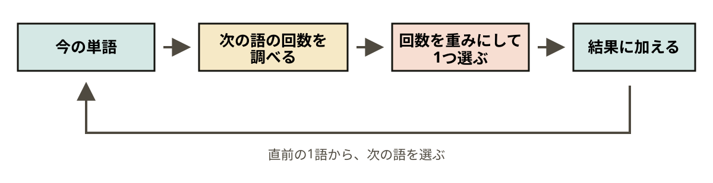
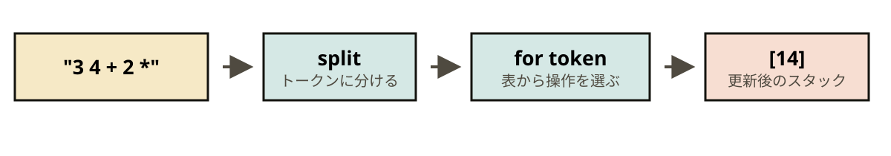

Scripting Languages / Dynamic Languages / 02

# テキスト処理と文章生成

### スクリプト言語演習

伊澤 侑祐

---

## 今日の道具は、状態・表・ループ

道具を一度に組み合わせず、4段階に分けて見ていく。

| 段階 | できるようになること | 主な道具 |
|---|---|---|
| 1. 分ける | 文章を単語の列にする | `with`, 正規表現 |
| 2. 数える | 単語のつながりを表にする | `zip`, `Counter` |
| 3. 選ぶ | 表から次の状態を決める | `sorted`, 重み付き抽選 |
| 4. 動かす | 表を引きながら状態を更新する | ループ、スタック |

最後に、同じ道具が文章生成と電卓の両方に使えることを確かめる。

---

## 文章を「数えられる単語」に変える
### 1. 分ける

- ファイルを1行ずつ読み、`#` で始まる行は飛ばす
- 大文字と小文字をそろえ、記号を取り除く
- `split()` では `world!` の `!` が残るため、正規表現で単語を抜き出す

```python
import re

line = "Hello, world! It's a nice day."

line.split()                         # 'world!' が残る
re.findall(r"[a-z']+", line.lower())
# ['hello', 'world', "it's", 'a', 'nice', 'day']
```

---

## ファイルは `with` で開き、行ごとに処理する
### 1. 分ける

```python
import re

tokens = []
with open("sample.txt", encoding="utf-8") as f:
    for line in f:
        if line.startswith("#"):
            continue
        tokens.extend(re.findall(r"[a-z']+", line.lower()))
```

- `with` を抜けるとファイルは自動で閉じる
- `append` はリストを1要素として追加する
- `extend` は取り出した単語を既存のリストへつなぐ

ファイルを読む処理と単語を抜き出す処理は、別々に試すと確認しやすい。

---

## 隣り合う語を数えると、続きを引ける
### 2. 数える

1語の出現回数だけでは、その語の後に何が続くか分からない。
そこで、隣り合う語をペアにして数える。

```python wrap
from collections import Counter, defaultdict

tokens = ["i", "like", "cats", "i", "like", "dogs"]
print(list(zip(tokens, tokens[1:])))

table = defaultdict(Counter)
for current, following in zip(tokens, tokens[1:]):
    table[current][following] += 1

print(table["i"])  # Counter({'like': 2})
```

`table["i"]` は「`i` の次に来た語」と、その回数を持つ。

---

## 辞書の中にカウンターを置くと、二段で数えられる
### 2. 数える

::: hstack 2 3
- 外側の辞書: 今の語を引く
- 内側の `Counter`: 次の語を数える
- `zip(tokens, tokens[1:])`: 隣接ペアを作る
|||
```python
table = defaultdict(Counter)
table["i"]["like"] += 1
table["i"]["love"] += 1
table["i"]["like"] += 1
```
:::

```text
"i"    -> {"like": 2, "love": 1}
"like" -> {"cats": 1, "dogs": 1}
```

単語のリストを隣接ペアに変え、そのペアをこの表へ加算する。

---

## 並べ替えると、よく現れる続きが見える
### 2. 数える

- `Counter.items()` で `(単語, 回数)` の組を取り出す
- 回数は降順、同数なら単語の辞書順にする
- 並び順を明示すると、同じ入力から常に同じ結果を得られる

```python
from collections import Counter

counts = Counter({"cat": 3, "zoo": 1, "ant": 1})
ranked = sorted(
    counts.items(),
    key=lambda item: (-item[1], item[0]),
)
print(ranked[:2])  # [('cat', 3), ('ant', 1)]
```

集計結果は、並べ替えて初めて人が読みやすい情報になる。

---

## 回数は、次の語を選ぶ重みに使える
### 3. 選ぶ

`i` の次に `like` が2回、`love` が1回あれば、
`like` を 2/3、`love` を 1/3 の割合で選ぶ。

```python
import random

words = ["like", "love"]
weights = [2, 1]
picked = random.choices(words, weights=weights)[0]
```

- `random.choice(...)`: 候補を等確率で選ぶ
- `random.choices(..., weights=...)`: 回数を重みにして選ぶ
- `choices` の返り値はリストなので、`[0]` で1語を取り出す

---

## ループでは、選んだ語が新しい状態になる
### 3. 選ぶ

::: hstack wrap 1 2
- **状態**: 現在の語 `word`
- **表**: 次の候補を持つ `table`
- **更新**: 選んだ語を `word` に入れる
- 次の候補がなければ終了する
|||
```python
word = "i"
result = [word]

for _ in range(5):
    # 今の word を使って次の語を選ぶ
    word = next_word
    result.append(word)
```
:::



---

## テキスト処理は、データを一段ずつ変換する
### ここまでの接続を確認する

```text
ファイル
  ↓ 読み込み・正規表現
単語のリスト
  ↓ zip・defaultdict・Counter
次の語と回数の表
  ↓ sorted                 表を観察する
  ↓ random.choices         表を使って選ぶ
新しい単語列
```

前段の出力が次段の入力になる。
思った結果にならなければ、一つ前の値へ戻って確認する。

---

## 重みを変形すると、選び方の大胆さが変わる
### 3. 選ぶ — 選び方を調整する

重みを `1 / T` 乗してから選ぶと、表を作り直さずに出力を変えられる。

```python
counts = [3, 1]
weights = [count ** (1 / temperature) for count in counts]
```

| 温度 | 重み `(3, 1)` | 出力の傾向 |
|---|---|---|
| `0.1` | `(59049, 1)` | 最頻語に強く偏る |
| `1.0` | `(3, 1)` | 元の集計どおり |
| `5.0` | `(1.25, 1)` | 等確率に近づく |

> 変えるのは選び方だけ。生成ループの骨格は変わらない

---

## 状態を長くすると、つながりは自然になる
### 3. 選ぶ — 状態を増やす

| 見る文脈 | 表のキー | 出力と表の傾向 |
|---|---|---|
| 直前1語 | `"the"` | 候補は多いが、意味が崩れやすい |
| 直前2語 | `("the", "queen")` | 自然になるが、組み合わせが増える |
| 長い文脈 | 長いタプル | 元文のコピーが増え、未知の並びに弱い |

```python
for a, b, following in zip(tokens, tokens[1:], tokens[2:]):
    table[(a, b)][following] += 1
```

> 状態を1語から2語へ増やしても、表を引いて更新する流れは同じ

---

## 状態は、単語だけでなく数の並びにもできる
### 4. 動かす

逆ポーランド記法では、数を積み、演算子で上の数を計算する。

| 読んだもの | 処理 | スタック |
|---|---|---|
| `3` | 数を push | `[3]` |
| `4` | 数を push | `[3, 4]` |
| `+` | 2つ pop し、和を push | `[7]` |

Python のリストをそのままスタックとして使える。

```python
stack.append(3)  # push
value = stack.pop()
```

> `10 3 -` は `7`。先に pop される `3` が右側の値

---

## 表には、数だけでなく関数も登録できる
### 4. 動かす

文章生成では「語 → 次の語と回数」を登録した。
電卓では「記号 → スタックを操作する関数」を登録する。

```python
WORDS = {}

def word(name):
    def deco(func):
        WORDS[name] = func
        return func
    return deco

@word("+")
def _(stack):
    b, a = stack.pop(), stack.pop()
    stack.append(a + b)
```

`@word` は第1回と同じ登録デコレータである。

---

## トークンを読むループが、表から処理を選ぶ
### 4. 動かす

::: hstack 2 3
- 空白で入力をトークンに分ける
- `WORDS` にあれば関数を呼ぶ
- 整数ならスタックへ積む
- どちらでもなければ `ValueError`
|||
```python
for token in text.split():
    if token in WORDS:
        operation = WORDS[token]
        operation(stack)
    else:
        stack.append(int(token))
```
:::

新しいワードを登録しても、`evaluate` は変更しない。



---

## スタック操作は、入る前と出た後で考える
### 4. 動かす

| ワード | 動作 | スタックの変化 |
|---|---|---|
| `DUP` | 一番上を複製 | `(a → a a)` |
| `DROP` | 一番上を捨てる | `(a → )` |
| `SWAP` | 上2つを入れ替える | `(a b → b a)` |
| `OVER` | 2番目を上にコピー | `(a b → a b a)` |
| `ROT` | 3番目を一番上へ移す | `(a b c → b c a)` |

すべて `@word(...)` で登録するため、評価ループから見れば同じ関数である。

---

## 道具は違っても、処理の骨格は変わらない
### 4段階を別の題材へ移す

| | 文章を作る機械 | 計算する機械 |
|---|---|---|
| 入力の分割 | 正規表現で単語へ | 空白でトークンへ |
| 状態 | 今の単語 | 数のスタック |
| 表 | 次の語と回数 | 記号と操作関数 |
| 表を引いた結果 | 次の語を選ぶ | 関数を呼ぶ |
| 更新 | 選んだ語へ進む | スタックを書き換える |
| 停止 | 次の語がない | 入力を読み終える |

文章と電卓は題材が違う。それでも、表を引いて状態を更新する点は同じである。

---

## 道具を一つずつ確かめてから組み合わせる
### まとめ

| やりたいこと | 使う道具 |
|---|---|
| ファイルを安全に読む | `with open(...)` |
| 必要な文字だけを抜く | `re.findall(...)` |
| 隣接する要素を組にする | `zip(xs, xs[1:])` |
| 二段の表で回数を数える | `defaultdict(Counter)` |
| 順位を決める | `sorted(..., key=...)` |
| 回数に応じて選ぶ | `random.choices(..., weights=...)` |
| 数を積み下ろしする | `append`, `pop` |
| 記号から処理を引く | 関数を値に持つ辞書 |

課題では、必要な道具を選び、状態・表・ループとして組み合わせる。
